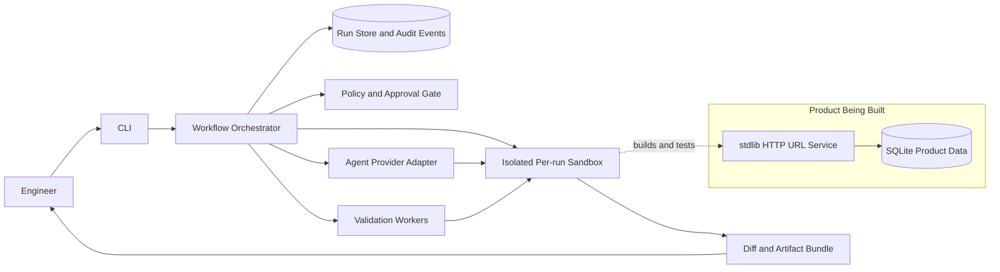

# Agentic Software Engineering System: URL Shortener

## 1. Objective and Scope

Build a runnable prototype that turns a software requirement into a reviewable engineering outcome: clarify intent, inspect context, propose an approved plan, execute work in a controlled workspace, validate it, and produce traceable artifacts. The example product is a URL shortener with core APIs, click analytics, and reliability features.

The orchestration layer is the critical deliverable, not a sequence of prompts. It coordinates requirements, design, implementation, testing, documentation, and release readiness. Normal task dependencies form a directed acyclic graph (DAG). Retries, repair loops, rollback, and re-planning are explicit governed runtime transitions outside the DAG.

Prototype boundary: local CLI, one model provider behind an adapter, isolated per-run workspace copies, SQLite persistence, and no automatic merge or production deployment. The implementation uses only the Python standard library so tests and stub-provider demonstrations work offline.

## 2. Architecture



### Components

- **CLI:** starts a run, supplies the requirement and repository, answers clarification requests, records human decisions, and displays status, events, metrics, and artifacts.
- **Workflow orchestrator:** validates graph revisions, schedules ready nodes, coordinates parallel work, synchronizes at dependencies and gates, carries typed run context, and applies retry, re-plan, rollback, and safe-stop policy.
- **Run store:** persists run status, graph revisions, node attempts, events, approvals, artifact references, metrics, and state snapshots in SQLite. A restart must not silently turn an in-progress run into success.
- **Policy and approval gate:** evaluates proposed actions, commands, and affected paths against autonomy rules before tools run. It fails closed when policy evaluation or required approval is unavailable.
- **Agent provider adapter:** isolates provider-specific prompts, tools, and response formats. The model proposes work; the orchestrator owns task state, policy, and execution control.
- **Workspace executor:** runs fixed allowlisted commands in a dedicated copy of the selected repository with timeouts and bounded output capture. Generated changes never touch the base repository directly.
- **Validation workers:** run focused tests and broader checks. Independent read-only checks (tests, lint, static security analysis) can run in parallel and synchronize at a validation gate. Serialize file-mutating work in the initial prototype.
- **Artifact bundle:** includes requirement interpretation, approved plan, decision lineage, changed-file diff, test/build output, risk notes, and release-readiness result.

### Target repository layout

```text
src/
    agentic_se/             CLI and run-bundle generation
    agent_runtime/          provider adapter, scenarios, isolated workspace
    workflow_engine/        graph, scheduler, context, policy, SQLite audit store
    url_shortener/          HTTP API, validation, service, SQLite repository
tests/
    test_engine.py
    test_runtime.py
    test_shortener.py
    test_scenarios.py
README.md
DESIGN.md
```

Keep the agent provider, persistent run store, workspace executor, and URL repository behind interfaces. A deterministic fake provider must be available so the full demonstration and tests run without network access or model credentials.

### Dependency-ordered 2–3 day implementation plan

1. **Day 1, contracts and product foundation:** normalize the shortener requirements; define API/schema acceptance criteria; implement SQLite repository and create/redirect/expiry behavior; add product unit and API integration tests. In parallel, define workflow/node/context/event contracts.
2. **Day 2, orchestration and governance:** implement DAG validation, ready-node scheduling with bounded concurrency, synchronization, durable run/event storage, approval gates, policy checks, isolated sandbox execution, and the fake/provider adapter. Connect test/build commands to structured failure events.
3. **Day 3, recovery and proof:** add bounded repair/retry, fallback, rollback, safe-stop, revision-aware re-planning, and event-derived metrics; run all three scenarios; harden tests; finish setup, architecture, limitations, and final engineering summary. If limited to two days, prioritize one worker, stub-provider scenarios, SQLite durability, and the approval/recovery tests before optional polish.

The dependency order is contracts -> product and runtime foundations -> governed execution -> recovery and scenario demonstrations. Product API work can proceed in parallel with graph/runtime foundations; integration waits until both are usable.

## 3. Workflow Orchestration

### Graph and node contract

Each graph revision contains named nodes with:

- stage/action type (`analyze`, `plan`, `edit`, `test`, `review`, `document`, or `release_check`)
- dependency node IDs and declared input/output artifact types
- retry limit, timeout, idempotency declaration, and failure policy
- autonomy class, affected path/resource scope, and required approval gate
- parent graph revision and requirement/context versions used to create it

The scheduler runs a node only when all dependencies have succeeded and policy checks pass. Ready independent nodes may run concurrently up to a configured worker limit. Synchronization nodes wait for all declared dependencies. File-writing nodes use one sandbox and are serialized unless conflict isolation is explicitly implemented.

Keep the dependency graph acyclic. Model retry, repair, rollback, and re-plan as explicit runtime transitions with their own event records. Before replaying a repair node, invalidate its outputs and those of dependent descendants; preserve completed unrelated branches. Record the triggering event, previous attempts, invalidated artifacts, and new attempt IDs.

### Run state and decision lineage

Persist a `RunContext` with:

- `run_id`, requester, repository identity, base revision, sandbox path, and current run status
- normalized requirement and version/hash; unresolved questions and accepted assumptions
- graph revision, node statuses, attempts, dependencies, and node input/output artifact IDs
- policy version, approvals/rejections, actor, timestamp, rationale, and approved scope
- ordered events, command results, test results, diff hashes, and rollback checkpoints

Node outputs are immutable artifacts identified by ID and content hash. A changed requirement, base commit, or upstream artifact creates a new graph/context revision; it does not rewrite past decisions. Approval is bound to the reviewed revision and scope. A material re-plan invalidates relevant approvals and requires approval again.

### Lifecycle gates

| Stage | Work | Exit gate |
| --- | --- | --- |
| Intake | Classify greenfield/brownfield, normalize intent, extract acceptance criteria and ambiguity | Stop and ask when material behavior or a safety boundary is unclear |
| Inspect | Read repository structure, conventions, tests, APIs/data flows, and Git state | Record base commit and impact map; no edits yet |
| Plan | Produce design notes and dependency graph; identify files, tests, risks, and rollback | Human approves scope, plan, and autonomy level before implementation |
| Implement | Apply scoped changes in the isolated sandbox; retain per-node artifacts and provenance | Policy allows paths/tools; elevated changes require separate approval |
| Validate | Run focused tests, then full tests/lint/security checks; parallelize independent checks | All required checks pass or bounded repair is entered |
| Review | Summarize diff, API/schema changes, test evidence, risks, and unresolved items | Human reviews final diff; rejection safely stops or triggers re-plan |
| Release readiness | Check clean status, migration/release notes, configuration, and rollback instructions | Explicit human approval; prototype never pushes, merges, or deploys automatically |

### Recovery and safe-stop policy

1. Retry transient infrastructure/tool failures at most two times with backoff. Do not retry deterministic policy denials or malformed plans.
2. On test/build failure, preserve logs, route to the approved repair node, invalidate affected descendants, and rerun relevant checks. Limit repair cycles per run (default two), then request human input.
3. If the primary agent/provider is unavailable, use one configured fallback only when policy says the task and data are eligible. Otherwise pause without losing run state.
4. Create a recoverable checkpoint before mutating nodes. Rollback restores only the sandbox to its last approved checkpoint; the source repository is never modified by the run.
5. Safe-stop on policy violation, approval rejection, unexpected base-branch movement, repeated validation failure, exhausted timeouts, secret detection, or an out-of-scope change. Preserve evidence and require a human to resume or abandon.

## 4. Policy and Autonomy Boundaries

- **Read-only autonomy:** inspect files, history, and test output within the selected repository.
- **Scoped-write autonomy:** edit allowlisted project files in the run sandbox after plan approval.
- **Elevated actions:** modify authentication/authorization, persistence schemas or migrations, dependency manifests, CI/release configuration, or security-sensitive behavior. Require separate human approval naming paths and intent.
- **Prohibited by default:** read or emit secrets, access unrelated directories, execute arbitrary network operations, alter the base branch, push, merge, deploy, or bypass failing checks.

Use argument arrays rather than shell interpolation; set explicit working directories and timeouts; pass a minimal environment; resolve symlinks before path-containment checks; scan diffs for secrets and out-of-scope files. Record approval decisions and tool outputs with repository-appropriate access controls. Never put credentials in prompts, logs, or run artifacts.

## 5. URL Shortener Product Design

### API

- `POST /api/v1/links` creates a short link. Request fields: `url`, optional `custom_code`, optional `expires_at`. Return `201` with code, short URL, destination, and expiry. Validate URL length and allow only `http` and `https` schemes.
- `GET /{code}` returns `302` to an active destination. Unknown or expired codes return `404`; expired links are never redirected.
- `GET /api/v1/links/{code}/analytics` returns total and daily click counts. Protect it with a configured API key; do not ship a permissive production default.
- Return structured `4xx` validation/conflict errors and do not expose internal exception details.

### Persistence and reliability

- `short_links`: code (primary key), destination URL, UTC creation time, nullable expiry time, and an idempotency key if create retries are supported.
- `click_events`: event ID, link code (foreign key), and UTC timestamp. Aggregate counts from events for the prototype. Do not persist raw IP addresses or full user-agent strings by default.
- Generate codes with a cryptographically secure random source; enforce uniqueness in the database and retry a bounded number of collisions. Validate custom codes and return `409` on conflict.
- Use Python's `http.server.ThreadingHTTPServer`, JSON from the standard library, and SQLite via `sqlite3`. Keep persistence behind the repository class so a production database can replace SQLite without changing API behavior.
- Redirect handling must not fetch the destination server-side, avoiding an SSRF path. Define backup/restore expectations and test expiry and uniqueness behavior.

## 6. Required Demonstration Scenarios

### Greenfield: implement the URL shortener

Intake converts the assignment into acceptance criteria and explicit assumptions. The approved graph implements API/schema, then runs independent unit/lint checks, synchronizes, runs API integration tests, generates setup/API documentation, and creates a review bundle. Human approval is required for the plan and release readiness; nothing is deployed.

### Brownfield: fix expired links still redirecting

Use a seeded repository with a failing regression test or reported bug. Inspection maps the redirect handler, expiry data, and existing tests. The plan adds a regression test before changing implementation. A failing test routes to a repair node; targeted tests rerun before the full suite. Work stays in an isolated sandbox and the final diff requires human review.

### Ambiguous: “Add analytics”

Identify unresolved choices: tracked events/dimensions, retention, privacy, access control, and historical backfill. Do not invent a broad tracking policy and start coding. Present a minimal option (click totals and daily counts without raw IP/user-agent storage), explain trade-offs, and ask the requester. The answer creates a new requirement revision, invalidates the old plan approval, and triggers a revised plan for approval.

## 7. Auditability and Reliability Metrics

Emit append-only structured events containing run ID, graph revision, node ID, attempt, timestamp, actor, outcome, and artifact references. Event kinds include run/node started, approval requested/granted/rejected, command completed, test/build failed, retry scheduled, loopback, re-plan, rollback, safe-stop, and run completed. Redact secrets before persistence.

Track at minimum:

- **Success rate:** completed runs divided by completed plus failed runs; report safe-stopped and user-abandoned runs separately.
- **Retry/rollback frequency:** retry and rollback events per run, broken down by failure category.
- **MTTR:** elapsed time from first actionable failure to successful validation or safe-stop resolution; report median and p95.
- **End-to-end latency:** intake to final review bundle, with stage and queue-time breakdowns.
- **Validation health:** pass/fail by check, repair-loop success rate, and repeated failure causes.

Metrics derive from persisted events, not model-generated summaries. Engineers must be able to trace any final artifact to its requirement version, approved plan, node attempts, commands, and validation evidence.

## 8. Setup, Validation, and Acceptance

The README provides local setup with Python 3.11 or newer and no third-party dependencies. In PowerShell:

```powershell
$env:PYTHONPATH = "src"
python -m agentic_se demo --scenario greenfield --provider stub
python -m agentic_se serve
python -m unittest discover -s tests -v
```

For a remote OpenAI-compatible provider, set `OPENAI_API_KEY`, `OPENAI_MODEL`, and optionally `OPENAI_BASE_URL`; the CLI asks for explicit network/data-egress approval. Never require a real model key to run tests or the three deterministic scenarios. Set `SHORTENER_ANALYTICS_API_KEY` before starting the service to enable protected analytics.

- Unit-test DAG validation, dependency ordering, parallel synchronization, bounded retries, repair invalidation, context/artifact propagation, approval invalidation on re-plan, and safe-stop behavior.
- Test approval enforcement for missing, granted, rejected, stale-revision, and out-of-scope approvals.
- Integration-test a greenfield run with a deterministic fake agent; verify the diff and test evidence are linked to the run.
- Test URL behavior: valid/invalid URLs, duplicate/custom codes, redirects, expiry, analytics aggregation, and analytics authorization.
- Exercise failing test/build commands; verify captured logs, bounded repair, rollback, and event/metric updates.
- Verify path traversal rejection, command timeout, secret redaction, and that the base branch remains unchanged.

Acceptance: all three scenarios are repeatable; independent DAG branches synchronize correctly; no high-impact action bypasses approval; failure loops are bounded; and every final artifact has traceable validation evidence.

## 9. Trade-offs, Risks, and Assumptions

- **SQLite and one local worker:** easy to run and inspect for an interview prototype, but not a multi-host durable queue. Keep storage and scheduling interfaces replaceable.
- **Single mutating sandbox:** limits parallel edit throughput but prevents concurrent file-write conflicts. Parallelize analysis and read-only validation first.
- **Human approval adds latency:** intentional for scope, elevated changes, and release readiness; low-risk read-only work can proceed without approval.
- **Agent output is untrusted:** validate structure, paths, commands, and diffs independently; generated reasoning is not proof of correctness.
- **Metrics need representative runs:** a few demonstrations prove instrumentation, not production reliability; do not present small-sample rates as guarantees.
- **Assumptions:** local development environment, Python available, operator supplies a configured model provider, and production deployment is not required by the assignment.
- **Out of scope for the first prototype:** multi-tenant hosted execution, automatic merge/deploy, distributed scheduling, advanced abuse detection, and production-grade analytics retention management.