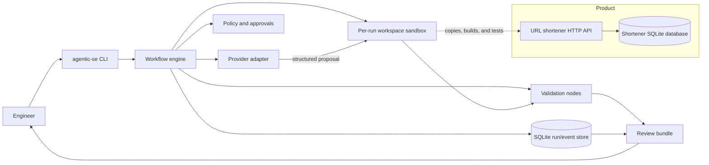

# Agentic Software Engineering System: Architecture and Summary

## Executive Summary

This repository implements a local Agentic Software Engineering System (Agentic SE) around a runnable URL shortener. The system accepts a requirement, checks for ambiguity, inspects a repository copy, proposes a plan, asks for human approval, performs scoped work in an isolated sandbox, runs validation, and packages evidence for review.

The governing principle is **controlled autonomy**. The agent provider supplies proposals; the workflow engine, policy checks, validators, and human reviewers control state changes. The system is designed to stop safely when requirements are unclear, policy denies an action, or a required human decision is unavailable. It never automatically merges or deploys an artifact.

This is a standard-library prototype, not a production deployment platform. The offline stub makes workflow behavior repeatable; it does not demonstrate model quality.

## Architecture at a Glance

### Component Responsibilities

| Component | Responsibility |
| --- | --- |
| CLI | Starts scenarios, collects clarification and approval input, exposes run/event inspection, and creates a review bundle. |
| Workflow engine | Validates dependencies, schedules runnable nodes, synchronizes parallel outcomes, applies policy, and records retries, replans, rollbacks, and terminal outcomes. |
| Provider adapter | Presents a common asynchronous completion interface for deterministic `stub` and opt-in `openai-compatible` providers. |
| Policy and approvals | Requires an approved plan for writes, checks declared affected paths, and fails closed when approval is absent or rejected. |
| Workspace sandbox | Copies the source tree per run, constrains writes, takes snapshots, and restores only the run copy. |
| Validation nodes | Run unit tests, compile checks, a credential-pattern scan, and integration tests. Independent nodes can execute concurrently. |
| SQLite run store | Persists run status, graph revision, sanitized context snapshots, and ordered events. |
| URL shortener | Demonstrates link creation, redirects, expiry, idempotency, protected click analytics, and request-rate controls. |

## Engineering Reasoning: Why These Choices

| Decision | Reasoning |
| --- | --- |
| Stateful DAG instead of linear chaining | A linear chain can conceal dependencies and propagate bad outputs after an earlier failure. A stateful DAG exposes dependencies, supports independent work in parallel, synchronizes at explicit exit criteria, and allows a failed branch to be invalidated and retried without replaying unrelated completed work. |
| Human-in-the-loop gates | Fully autonomous code changes and release decisions create security, compliance, and accountability risks. Explicit `APPROVE` decisions at plan, review, and release-readiness gates retain human authority over high-impact state changes. A clarification replan also requires an approval decision. |
| Safe-stop instead of blind retries | Indefinite retries consume provider/API credits, can repeat harmful actions, and can enter loops. Retries are bounded; ambiguity, policy denial, rejected approval, and non-interactive approval requests stop safely and preserve audit evidence. |
| Isolated sandbox (`src/agent_runtime/sandbox.py`) | Writing directly to the host repository risks corruption and makes rollback unsafe. Each run works in a temporary repository copy; paths are contained, symlink traversal is rejected, and rollback restores that copy rather than the base working tree. |
| SQLite audit logging (`.agentic_se/runs.sqlite3`) | Governance needs durable decision lineage, state snapshots, and measurable outcomes. SQLite provides inspectable local persistence without adding a service dependency. It is appropriate for this prototype, not a multi-host production queue. |
| Provider abstraction | Scenario logic need not depend on one model vendor or network availability. The stub supports deterministic offline validation; the remote adapter is explicit opt-in and receives a separate data-egress confirmation. |

## Workflow and Orchestration Mechanics

### Normal Execution Graph

The URL-shortener scenario defines these dependency stages:

1. `intake` captures the requirement and blocks on unresolved ambiguity.
2. `inspect` inventories relevant repository paths and project context.
3. `draft_plan` produces a proposal for reviewer inspection.
4. `plan_approval` obtains approval and creates the `approved-plan` sandbox checkpoint.
5. `implement` applies a bounded file manifest inside the sandbox.
6. `unit_tests`, `lint_compile`, and `security_scan` are independent validation nodes and may run concurrently.
7. `integration_tests` waits for all three checks to succeed.
8. `documentation` runs after implementation; `review_prepare` waits for documentation and integration evidence.
9. `review_approval` and `release_readiness` are separate human gates.

The engine schedules ready steps with `asyncio.gather`, up to four concurrent steps by default, then advances only after dependencies complete. File-writing work remains scoped to the sandbox. Normal dependencies must be acyclic; retries, repair, rollback, and replanning are explicit, bounded runtime transitions.

On a validation failure with a configured failure target, the engine calls the rollback handler, restores the approved-plan snapshot, invalidates the target step and descendants, and runs that slice again. A loopback limit prevents unbounded repair. Run context includes state, outputs, attempts, graph revision, metadata, and approval/replan lineage.

### Provider Modes and Trust Boundary

| Provider | Behavior | Operational boundary |
| --- | --- | --- |
| `stub` | Deterministic, offline text and a small code manifest for repeatable runs. | Confirms orchestration and artifact handling, not semantic completeness or model quality. |
| `openai-compatible` | Sends prompts to an HTTPS-compatible chat-completions endpoint. | Requires `OPENAI_API_KEY`, optional `OPENAI_MODEL`/`OPENAI_BASE_URL`, and an interactive `ALLOW NETWORK` confirmation. Requirement text and a repository path inventory leave the local machine. |

Provider output is untrusted. The workflow validates a JSON manifest, restricts generated paths to `src/url_shortener/`, checks content size and duplicates, and writes only through the sandbox. The model has no direct shell or host-filesystem access. A human must inspect and manually promote acceptable artifacts.

### Human Approval Semantics

The CLI asks for the exact uppercase token `APPROVE` at the plan, review, and release-readiness gates. The prompt displays the stage, revision, affected paths, and review artifact when available. A rejected decision or absent interactive terminal fails closed. The ambiguous scenario's graph replan is a further approval decision, distinct from the three ordinary lifecycle gates. Approval lineage records actor, rationale, step, and revision in the current run context/event history.

## Sandbox and Recovery Boundaries

- Each run copies the source to `.agentic_se/workspaces/<run-id>`; generated changes do not modify the base repository.
- The sandbox excludes common generated/dependency directories such as `.git`, `.agentic_se`, virtual environments, bytecode caches, and `node_modules`.
- Writes reject absolute paths, parent traversal, symlink traversal, and paths outside configured prefixes.
- The approved plan produces a snapshot. Rollback deletes and reconstructs only the run workspace from that snapshot.
- Commands execute as argument arrays rather than shell strings and have configured timeouts; stdout/stderr are captured into structured failures.
- Repair and provider fallback are bounded. Policy denial, blocked clarification, rejected approval, and exhausted repair are not blindly retried.
- A run artifact bundle contains `run.json`, `events.json`, `metrics.json`, `summary.md`, and review/changed-file material where available.

## Audit and Persistence Schema

The workflow audit database defaults to `.agentic_se/runs.sqlite3`. Current implementation uses SQLite WAL mode and physically creates these tables:

| Table | Columns / purpose |
| --- | --- |
| `runs` | `run_id` primary key, `workflow_name`, `status`, `started_at`, `ended_at`, `graph_revision`, and sanitized `context_json`. The status is updated as events arrive. |
| `events` | Autoincrement `sequence`, `run_id` foreign key, `kind`, `timestamp`, and `payload_json`; indexed by `(run_id, sequence)` for ordered run history. |

**Schema fidelity note:** the current database does not create physical `checkpoints` or `approvals` tables. Checkpoint operations and approval decisions are represented through the run's event/context lineage and sandbox snapshot directories. In a production schema, first-class checkpoint and approval tables would be sensible additions, with foreign keys to the run and revision, immutable actor/scope/rationale records, and snapshot hashes.

Context and event payloads are redacted before persistence using sensitive-key and secret-pattern filters. Treat this as defense in depth, not a substitute for keeping secrets out of prompts and run artifacts. The shortener product database is separate from the workflow audit database.

### Metrics and Definitions

The audit export reports completed runs over terminal runs for `success_rate`; `running` records are excluded from the denominator. MTTR is computed from the first `step_failed` or `safe_stop` event to the terminal `run_completed` or `safe_stop` event for qualifying runs, then averaged. It is a small demonstration sample, not an SLO.

| Metric | Audit value |
| --- | ---: |
| Total run records | 7 |
| Completed | 3 |
| Safe-stopped | 3 |
| Still running in export | 1 |
| Rollback count | 1 |
| Retry count | 0 |
| Success rate | 0.5 |
| MTTR | ~10.63 s (10.63317875 s recorded) |
| Mean end-to-end latency | 122.7480115 s |

## Brownfield Scenario Deep-Dive

### Regression Being Demonstrated

The brownfield requirement is to fix an expired-link redirect regression. The concrete contract is that the redirect handler must check expiry before returning a destination: an expired code must return `404 Not Found`, never an active redirect. The regression test is `test_expired_link_is_not_redirected` in `tests/test_shortener.py`; it sets an expiry timestamp in the past and asserts that the redirect request raises HTTP 404. A regression that bypasses the expiration check would fail this assertion by returning a redirect instead.

### Current Prototype Execution

There is an important distinction between the scenario narrative and what the current implementation executes. The scenario code does **not** rewrite or inject a defect into `src/url_shortener/service.py`. On the first brownfield implementation round, the `unit_tests` scenario action emits a deterministic synthetic failure event labeled `expired_links_do_not_redirect`. The engine then restores the sandbox from the checkpoint made at `plan_approval`, records a rollback/loopback, and reruns implementation. Later, `integration_tests` executes the actual shortener test suite, including `test_expired_link_is_not_redirected`, against the sandbox. The regression test itself verifies the correct expiry behavior; the repair loop is orchestration evidence, not a demonstrated source-code repair patch to `service.py`.

The audit records brownfield run `362ec5ec-03db-40bf-ab01-4e5e749ccd3f` as completed with rollback count 1. The supplied audit metrics report MTTR of approximately 10.63 seconds. The base repository is not mutated. This documentation note is intentional so audit readers can distinguish deterministic scenario signaling from an actual injected-and-repaired product defect.

## Ambiguous Requirements Deep-Dive

“Add analytics” is underspecified: event dimensions, retention, privacy boundaries, and access control are not defined. Without a clarification, `intake` records open questions and raises a workflow block; the engine safe-stops rather than inventing a tracking policy.

The operator can provide the agreed minimum scope with `--answer`: total and daily click counts, no personal identifiers, analytics protected by an API key. The run requests approval for the replan, clears stale outputs/attempts, increments the graph revision, then continues with revised context and normal approval gates. The clarified audit run is `8f8524ec-724a-4f4e-94fe-305bdfc55a54`, completed at graph revision 2.

## Audit Run History

| Run ID | Scenario | Status | Revision | Notes |
| --- | --- | --- | ---: | --- |
| `8f8524ec-724a-4f4e-94fe-305bdfc55a54` | Ambiguous | Completed | 2 | Continued after clarification. |
| `362ec5ec-03db-40bf-ab01-4e5e749ccd3f` | Brownfield | Completed | 1 | One rollback. |
| `e27a0476-c9ef-4e50-8ec8-6d68d4240c10` | Greenfield | Completed | 1 | Full successful scenario. |
| `85fa36d9-44c6-41c3-9cfd-3d06e2c405d7` | Greenfield | Safe-stopped | 1 | Governance halt; audit scenario notes cite non-`APPROVE` input or terminal-buffer timing. |
| `afac1748-fb9b-4237-a155-d2fc91e063d5` | Greenfield | Safe-stopped | 1 | Governance halt; audit scenario notes cite non-`APPROVE` input or terminal-buffer timing. |
| `1dda1830-4c67-4f8a-adee-e5f40280d8d6` | Greenfield | Running | 1 | Non-terminal record at export time. |
| `f5d51106-4d9a-4316-8f18-90fe47bc1f63` | Greenfield | Safe-stopped | 1 | Third safe-stop included in totals. |

The two named safe-stop examples demonstrate fail-closed approval handling. The approval prompt accepts the exact string `APPROVE`; non-interactive execution is rejected, and input sent before a prompt is actually active may not be consumed as the intended decision. See [RUNBOOK.md](RUNBOOK.md) for terminal operation guidance.

## URL Shortener Product Surface

| Route | Behavior |
| --- | --- |
| `POST /api/v1/links` | Creates a link; supports optional custom code, timezone-aware expiry, and `Idempotency-Key`. Invalid input returns 422; conflicts return 409. |
| `GET /{code}` | Redirects active links with 302; unknown or expired links return 404. |
| `GET /api/v1/links/{code}/analytics` | Returns total and daily click counts and requires a configured Bearer API key. Missing configuration returns 503. |
| `GET /healthz` | Returns a basic health response. |

The product SQLite database is configurable with `SHORTENER_DATABASE`. Analytics uses `SHORTENER_ANALYTICS_API_KEY`. Link creation and redirects have in-memory per-client limits of 60 and 120 requests per minute respectively; these limits are transient and intended for a single-process prototype.

## Operational Limitations and Production Considerations

- SQLite and local workspaces are single-machine demonstration infrastructure, not a distributed queue or multi-tenant isolation boundary.
- The stub emits a deliberately small artifact and does not implement a complete new shortener product.
- The brownfield repair loop is currently driven by a deterministic failure signal rather than an actual source regression and patch.
- The current audit schema has no first-class checkpoint or approval tables; those concepts are encoded in event/context lineage and snapshot files.
- The remote provider transmits requirement text and repository path inventory after explicit consent. Do not include secrets or sensitive data.
- A human must review and manually promote generated changes; release readiness is an approval checkpoint only.
- Sample counts are too small to support production reliability claims. Define production SLOs, access controls, retention, backup, recovery, and multi-process coordination before deployment.

See [README.md](README.md) for a project overview and [RUNBOOK.md](RUNBOOK.md) for setup, scenarios, audit export, and troubleshooting.