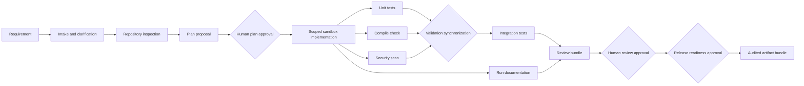

# Agentic Software Engineering System

A local, governed software-engineering orchestrator demonstrated against a URL shortener. It turns a requirement into a scoped plan, controlled sandbox work, validation evidence, and a human-reviewed artifact bundle. Its central operating principle is **controlled autonomy**: automation can propose and test changes, while people retain authority over high-impact decisions.

The prototype runs offline with Python's standard library and a deterministic stub provider. It does not merge or deploy generated changes.

## Start Here

From the repository root in PowerShell:

```powershell
$env:PYTHONPATH = "src"
python -m agentic_se demo --scenario greenfield --provider stub
```

Run history and review artifacts are written beneath `.agentic_se/`. Approval gates are interactive and fail closed when no terminal reviewer is available. Review the displayed artifact and enter the exact word `APPROVE` at each approval prompt to continue.

## Capabilities

- Stateful, dependency-checked workflow DAG with bounded retries, explicit repair/rollback transitions, and requirement revisions.
- Parallel execution of independent validation nodes, synchronized before integration tests and review.
- Human gates for plan approval, final review, and release readiness; the system itself does not publish or deploy.
- Per-run repository copy with path containment, symlink checks, checkpoints, and sandbox-only rollback.
- Pluggable provider interface: offline `stub` or opt-in `openai-compatible` provider.
- SQLite run/event persistence, sanitized context snapshots, event-derived metrics, and per-run review bundles.
- Runnable URL shortener with expiration, idempotent creation, protected click analytics, and in-memory rate limits.

## Architecture Flow



Independent checks run concurrently when their dependencies are satisfied. The engine synchronizes at dependency boundaries, and failure recovery is a bounded runtime transition rather than a cycle in the normal task graph.

## Evaluation Alignment

| Evaluation concern | Evidence in this repository |
| --- | --- |
| Non-linear orchestration | Acyclic dependency graph, concurrent ready steps, explicit synchronization, and revision-aware replanning |
| Human oversight | Interactive approval decisions and audited approval events at plan, review, and release-readiness stages |
| Recovery and safety | Bounded retry/repair, approved-plan checkpoint, sandbox rollback, fail-closed stops, and path policy |
| Validation | Unit, compile, security-scan, and integration nodes plus a complete `unittest` suite |
| Auditability | SQLite run/event history, context lineage, review bundles, and run metrics |
| Reproducibility | Standard-library implementation and deterministic offline provider |

## Audit Snapshot

The checked-in audit export records **7 total runs**, **3 completed**, **3 safe-stopped**, **1 rollback**, **MTTR ~10.63 seconds**, and **success rate 0.5**. The success-rate denominator is the six terminal runs; the export also contains one run left in `running` status. These are demonstration results, not production reliability guarantees.

| Scenario | Run ID | Outcome |
| --- | --- | --- |
| Greenfield | `e27a0476-c9ef-4e50-8ec8-6d68d4240c10` | Completed |
| Brownfield | `362ec5ec-03db-40bf-ab01-4e5e749ccd3f` | Completed; rollback count 1 |
| Ambiguous, clarified | `8f8524ec-724a-4f4e-94fe-305bdfc55a54` | Completed at graph revision 2 |
| Safe-stop example | `85fa36d9-44c6-41c3-9cfd-3d06e2c405d7` | Safe-stopped |
| Safe-stop example | `afac1748-fb9b-4237-a155-d2fc91e063d5` | Safe-stopped |

The full run history, architecture decisions, known implementation boundaries, and operational procedures are documented here:

- [Architecture and system summary](ARCHITECTURE_AND_SUMMARY.md)
- [Operational runbook](RUNBOOK.md)
- [Original design notes](DESIGN.md)

## Requirements and Validation

- Python 3.11 or newer.
- No third-party packages for the stub provider, HTTP service, or tests.
- Run the complete suite with `python -m unittest discover -s tests -v` after setting `$env:PYTHONPATH = "src"`.

For detailed scenario commands, interactive-terminal guidance, audit export, and troubleshooting, see the [runbook](RUNBOOK.md).

## Provider and Product Notes

The remote provider is opt-in and requires a separate `ALLOW NETWORK` confirmation. It receives requirement text and a repository path inventory; generated content is untrusted and is validated and written only in the run sandbox. See the runbook before enabling it.

The shortener listens on `http://127.0.0.1:8000` by default. Link creation accepts `url`, optional `custom_code`, and optional timezone-aware ISO-8601 `expires_at`. Analytics requires a configured API key. This is a local prototype: the HTTP server, SQLite persistence, and rate limits are not a production multi-tenant deployment.
